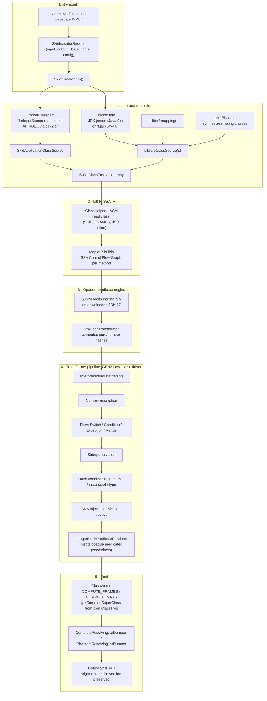

# Skidfuscator — How It Works

This document describes the end-to-end obfuscation pipeline: how a JAR flows
from input to obfuscated output, and which components are responsible for each
stage.

## Pipeline overview

## Stage notes

1. **Import & resolution.** The input JAR (or APK/DEX) is read into a
   `SkidApplicationClassSource`. The JDK runtime is imported as library classes —
   from the running JVM's `jmods` on Java 9+, or `rt.jar` on Java 8 — so references
   to standard-library types resolve. Extra dependencies come from `-li`; missing
   classes can be synthesized with JPhantom (`-ph`).

2. **Lift to SSA IR.** Each class is read with ASM (via `ClassHelper`, inlining JSR
   and skipping frames) and each method is lifted into MapleIR's **SSA control-flow
   graph**. Working in SSA form is what lets the flow transforms mangle control flow
   without blowing up time/space complexity.

3. **Opaque-predicate engine (SSVM).** For the "pure"/number obfuscation,
   Skidfuscator boots an embedded [SSVM](https://github.com/terminalsin/SSVM)
   virtual machine against a downloaded **JDK 17** image (cached in `~/.ssvm/jdk`).
   It executes small pure functions to derive deterministic hash values used as
   opaque predicates. This internal VM is pinned to JDK 17 and is independent of
   both the JVM running Skidfuscator and the Java version of the input; candidates
   it cannot load are skipped gracefully.

4. **Transformer pipeline.** An event-driven pipeline (`EventBus`) runs the
   configured transformers over every class/method: interprocedural hardening,
   number & string encryption, the GEN3 flow passes (switch, condition, exception,
   range), hash-based checks, SDK injection and decoys. The
   `IntegerBlockPredicateRenderer` then threads opaque predicates (per-method seeds
   and keys) through the graph. Each pass is toggled and tuned via the HOCON config
   (see [USAGE.md](USAGE.md)).

5. **Emit.** Transformed methods are written back with ASM. Frame/stack computation
   resolves common supertypes from Skidfuscator's **own** class tree (not the host
   classloader), so it works for any supported Java version. The dumper writes the
   classes, resources and the injected runtime SDK into the output JAR, **preserving
   the original class-file version** of every class.

## Module map

| Stage | Module(s) |
|-------|-----------|
| CLI / GUI / session | `dev.skidfuscator.client.standalone` |
| Orchestration & transformers | `dev.skidfuscator.obfuscator` |
| SSA IR, class I/O (ASM) | `org.mapleir.parent/*` (MapleIR, `modasm`) |
| Phantom resolution | `dev.skidfuscator.obfuscator.dependanalysis` + JPhantom |
| Pure/number VM | `dev.skidfuscator.obfuscator.pureanalysis` + SSVM (`io.github.terminalsin:SSVM`) |
| Injected runtime SDK | `dev.skidfuscator.sdk` |

See [USAGE.md](USAGE.md) for the command-line parameters and configuration reference.
